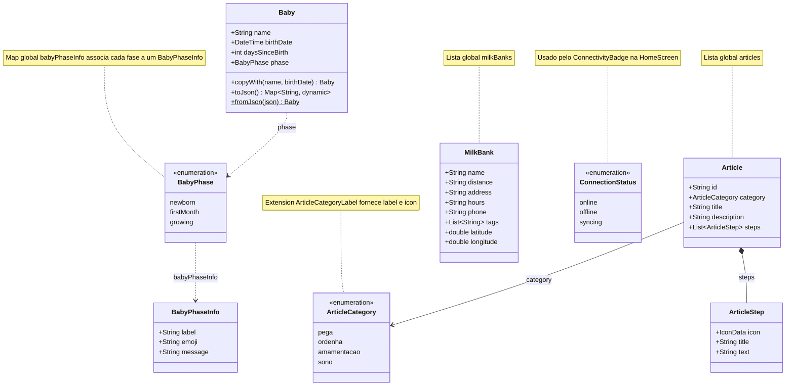

# Diagrama de classes — Modelos

Entidades de domínio do app: dados do bebê, catálogo de conteúdos e bancos de leite. As coleções globais (`articles`, `milkBanks` e `babyPhaseInfo`) são indicadas em notas para não poluir o diagrama.

