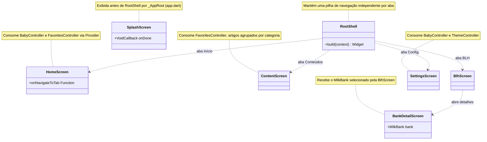

# Diagrama de classes — Telas principais

Telas de navegação do app e a casca `RootShell`, que mantém uma pilha de navegação por aba. Widgets visuais auxiliares e telas secundárias foram omitidos para manter o diagrama legível.

