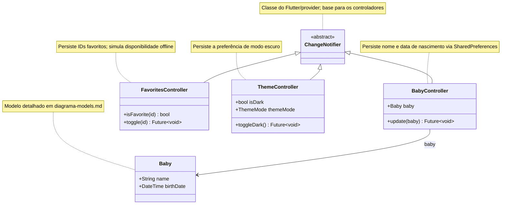

# Diagrama de classes — Serviços e estado

Controladores que estendem `ChangeNotifier` e concentram o estado global do app. Cada um persiste sua preferência com `SharedPreferences` e notifica a UI por `notifyListeners()`.

