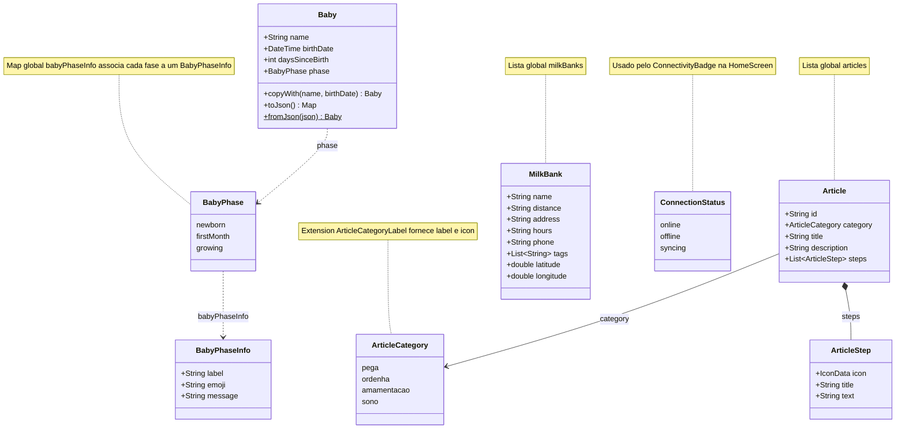
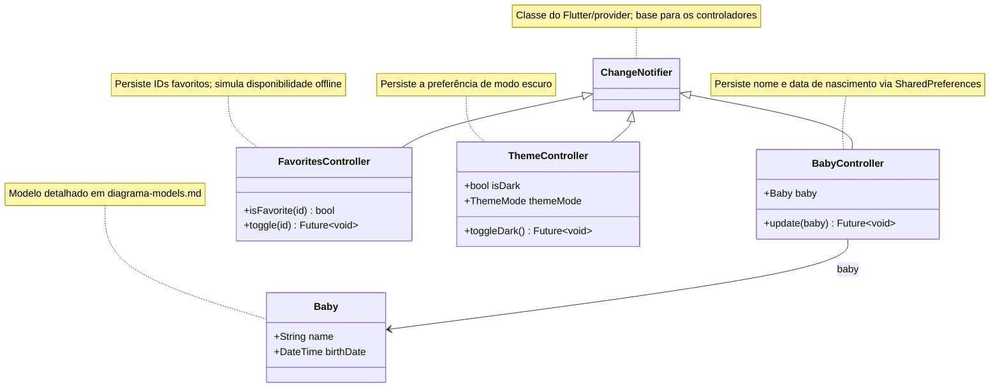
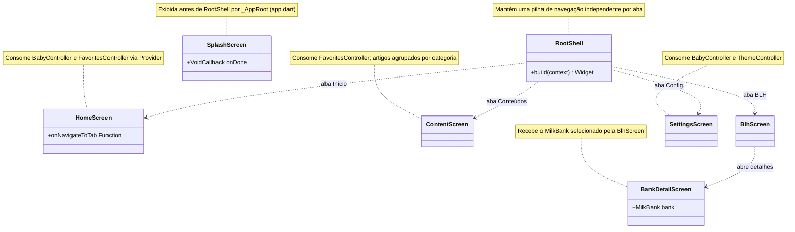

# Diagramas de classes — Colo de Mãe

Diagramas gerados a partir do código real do app Flutter (`Api/colodemae_flutter/lib`) com a ferramenta `dcdg` e revisados manualmente. Para manter a leitura, o projeto foi dividido por camada e os widgets visuais de baixo nível, as classes privadas e os utilitários foram omitidos.

**Legenda:** `*--` composição, `-->` associação, `..>` dependência/uso, `<|--` herança.

## Modelos

Entidades de domínio do app: dados do bebê, catálogo de conteúdos e bancos de leite. As coleções globais (`articles`, `milkBanks` e `babyPhaseInfo`) são indicadas em notas para não poluir o diagrama.

`BabyPhase`, `ArticleCategory` e `ConnectionStatus` são enumerações.

## Serviços e estado

Controladores que estendem `ChangeNotifier` e concentram o estado global do app. Cada um persiste sua preferência com `SharedPreferences` e notifica a UI por `notifyListeners()`.

`ChangeNotifier` é uma classe abstrata do Flutter.

## Telas principais

Telas de navegação do app e a casca `RootShell`, que mantém uma pilha de navegação por aba. Widgets visuais auxiliares e telas secundárias foram omitidos para manter o diagrama legível.

